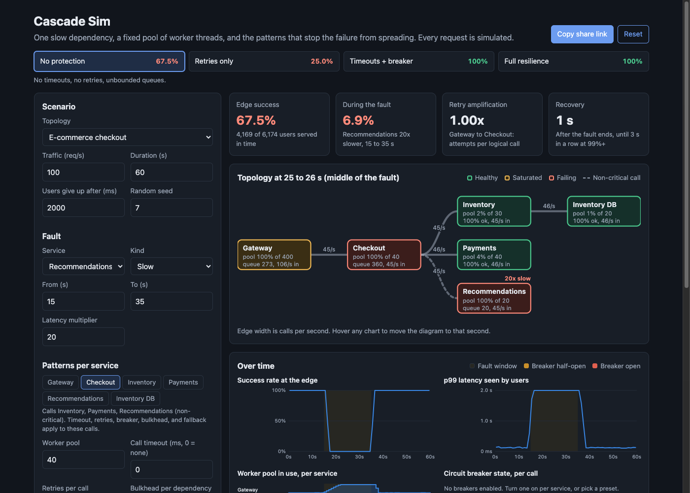

# Cascade Sim

A browser simulator that shows how one slow dependency takes down a whole microservice system, and how timeouts, retries, circuit breakers, bulkheads, load shedding, and fallbacks contain it. Every request is simulated with a discrete-event engine: worker pools, queues, lognormal latency, and synchronous downstream calls.



## Why

Most outages in a service mesh are not caused by the service that broke. They are caused by everything above it waiting on it. Each service has a fixed pool of worker threads, and a worker stays busy while it waits on a downstream call. When one dependency gets slow, its callers' pools fill up with waiting workers, new requests queue, and the failure climbs the call graph until the edge is down.

The default scenario is a checkout flow. Recommendations is a non-critical call that gets 20 times slower for 20 seconds. Payments and inventory stay healthy the whole time.

| Preset | What it does | Edge success | During the fault |
|---|---|---|---|
| No protection | No timeouts, unbounded queues | 67.5% | 6.9% |
| Retries only | 3 immediate retries, triggered by a 1 s default timeout | 25.0% | 2.4% |
| Timeouts + breaker | 250 ms timeout, breaker on every call, fallback for recommendations | 100% | 100% |
| Full resilience | Adds retries with backoff and jitter below the edge, bulkheads, queue limits | 100% | 100% |

With no protection, checkout's 40 workers all end up waiting on recommendations, and checkout success drops to near zero although payments and inventory are fine. Naive retries make it worse: the gateway sends 3.2 calls to checkout for every user request, checkout's queue reaches 6,580, and the system never recovers after recommendations is healthy again. That is a retry storm: the extra load keeps the queue full on its own. A tight timeout, a breaker, and a fallback keep checkout at 100%: users get a checkout page without recommendations for 20 seconds.

The simple chain topology shows the other half of the lesson. When the slow service is critical (an orders database), no pattern can make requests succeed. A breaker still helps by failing fast, which keeps p99 latency low and stops queues from building.

## How it works

```
users (Poisson) ──> Gateway ──> Checkout ──┬──> Inventory ──> Inventory DB
                                           ├──> Payments              (critical)
                                           └──> Recommendations       (non-critical)
```

- **Services** have a worker pool, an inbound queue, a lognormal latency, and a list of calls made one after another. A worker is held for the whole request, including the time spent waiting on calls.
- **Users** arrive as Poisson traffic at the edge and give up after 2 seconds. A request counts as a success only if the edge answers OK before that.
- **Faults** make one service slow (latency multiplier) or erroring (error rate) between two times.
- **Patterns** are set per service and apply to its outbound calls:
  - Timeout: give up on a call after N ms. The downstream keeps working on it, as in real systems.
  - Retries: N retries per call, immediate or with exponential backoff and full jitter.
  - Circuit breaker: opens when the error rate over the last N calls reaches a threshold, fails fast for a cooldown, then lets a few trial calls through (half-open) before closing.
  - Bulkhead: caps concurrent calls to each dependency, so one slow dependency cannot hold every worker.
  - Queue limit: sheds load instead of queueing without bound.
  - Fallback: a failed non-critical call becomes a degraded success. Critical calls still fail.

The engine is in `src/sim.js` with no DOM code: a binary-heap event queue (ties broken by insertion order), a seeded `mulberry32` RNG, and per-second metrics. A 60 second run at 100 req/s is about 40,000 to 200,000 events and takes 50 to 200 ms in the browser.

## What you see

- **Presets** with the edge success rate each one gets on the current traffic and fault.
- **Cards**: edge success, success during the fault, the worst retry amplification (attempts per logical call on any edge), and how long recovery takes after the fault ends.
- **Topology diagram**: nodes colored by health for one second of the run, edges sized by calls per second, open breakers marked. Hover any chart to move it through time.
- **Small multiples** on one time axis: edge success rate, p99 latency seen by users, pool usage per service, and breaker state per call. The fault window is shaded.
- **Per-service table**: requests, success rate, p50 and p99, max queue, retries sent, timeouts, and calls shed or failed fast.

All settings live in the URL hash, so a scenario can be shared as a link.

## Run it

It is a static site with no build step and no dependencies. ES modules need a web server, so `file://` will not work. From this folder run:

```bash
python3 -m http.server 8000
```

Then open http://localhost:8000.

## Tests

```bash
npm test        # or: node --test
```

26 tests cover the engine:

- RNG determinism, the lognormal median and tail, and event ordering (including ties and 2,000 random events).
- A saturated pool queues requests; a queue limit sheds them instead.
- A timeout fires before a slow response; without one the caller waits.
- Retries amplify load by exactly 4x when every call fails with 3 retries, and by 1 + p + p² + p³ at error rate p. Backoff spreads retries out without changing the count.
- Breaker transitions: closed to open on error rate, fail fast during cooldown, half-open with a fixed number of trial calls, closed on good trials, reopened on bad ones, and closed below the threshold.
- Bulkhead isolation keeps a slow dependency from holding the whole pool.
- Fallback rescues a non-critical call but not a critical one.
- The four presets order as expected: retries only < no protection < timeouts + breaker <= full resilience, with the last two above 99%.
- The default story holds (checkout saturates while payments and inventory stay healthy), retries only causes a storm that outlasts the fault, and config round-trips through the URL hash.

## CI and deploy

`.github/workflows/ci.yml` runs the tests on every push and pull request. On push to `main` a second job publishes the site to GitHub Pages with `actions/upload-pages-artifact@v3` and `actions/deploy-pages@v4`. Set Pages to "GitHub Actions" as the source in the repo settings. The workflow has not been run locally.

## Production notes

- Real systems run calls in parallel and use async I/O, which changes how fast pools fill but not the shape of the failure. The thread-per-request model here is the clearest case and still common in Java and Python services.
- Propagate deadlines. Here, work keeps running after the caller gave up. gRPC deadlines or a timeout header let downstream services drop work nobody is waiting for.
- Retry at one layer only, with a retry budget (for example, retries capped at 10% of requests) as well as backoff. Multi-layer retries multiply: 3 retries at two layers is up to 16 calls.
- Tune breaker thresholds per dependency. A breaker on a critical call that sees 30% errors can do more harm than the errors, because it fails the other 70% too.
- In a service mesh (Envoy, Istio, Linkerd) most of these patterns are configuration, not code: outlier detection, connection pool limits, and retry policies per route.
- Watch pool utilization and queue depth, not just error rate. In the default scenario checkout's error rate is 0% while it is down.

## License

MIT. See [LICENSE](LICENSE).
